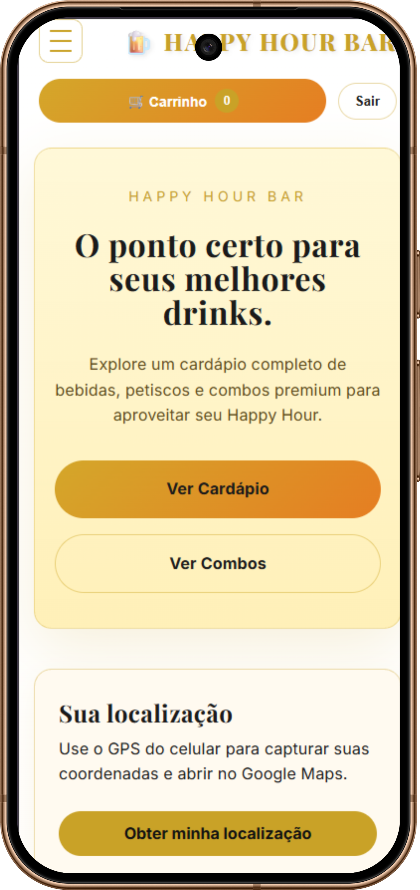
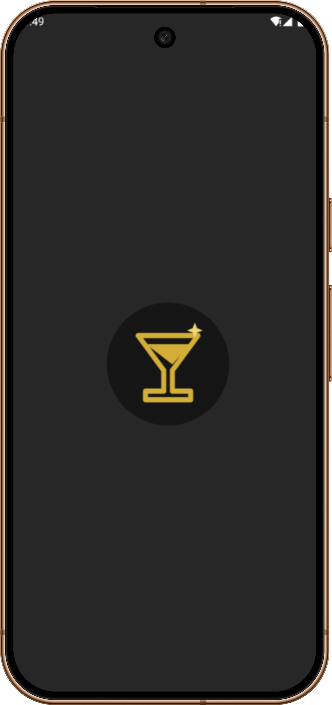
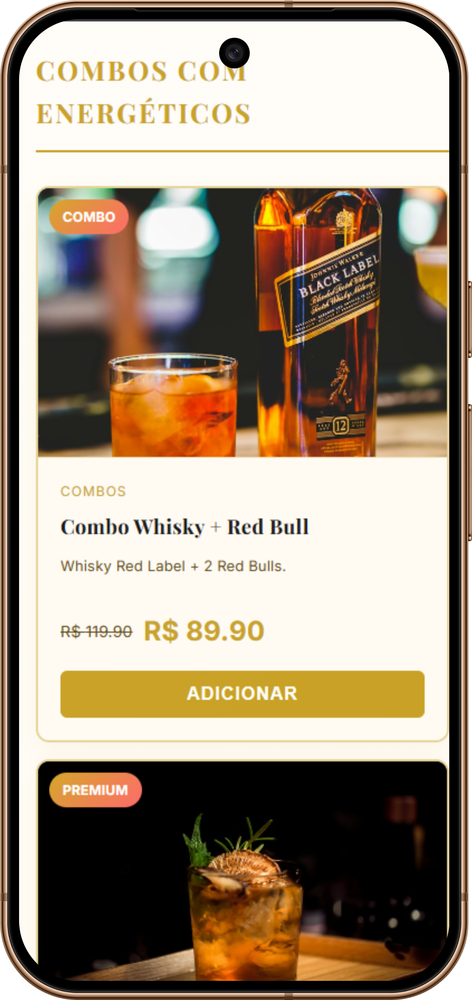

# Cardápio Bar

## Apresentação do app

Confira as telas do Cardápio Bar em mockups do Google Pixel 11 Pro.

  
  
  

## Android APK

O workflow `Build Android APK` gera um APK de depuracao quando ha um push para `main` ou `master`. Tambem pode ser iniciado manualmente na aba **Actions**. Baixe o arquivo `cardapio-bar-debug-apk` em **Artifacts** ao final da execucao.

## Camera e galeria

O app abre a camera ou o seletor de fotos do Android. As imagens escolhidas sao enviadas ao bucket `product-images` do Supabase para continuarem acessiveis depois que o produto e salvo.

Antes de usar esse recurso, execute `supabase/product-images-storage.sql` no SQL Editor do projeto Supabase. O usuario precisa estar autenticado para enviar imagens.
